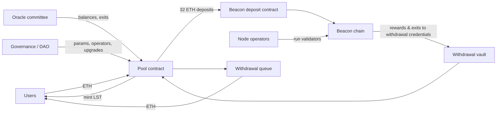

# Liquid Staking Designs and the Threat Model

Staking ETH directly locks it in a validator. A liquid staking protocol takes deposits, runs or delegates validators, and gives depositors a liquid staking token (LST) they can trade or use as collateral. The LST is a claim on staked ETH plus rewards minus penalties. Everything in this book comes back to one question: how does the contract know what that claim is worth, and who can change the answer?

## Rebasing versus reward-bearing

| Design | How rewards reach holders | Balance changes? | Examples | Integration notes |
|---|---|---|---|---|
| Rebasing | `balanceOf` grows when the oracle reports rewards | Yes, without transfers | stETH (Lido) | Breaks code that caches balances; transfers can lose 1–2 wei to share rounding |
| Reward-bearing (exchange rate) | Token count fixed; redemption rate ETH-per-token rises | No | rETH (Rocket Pool), cbETH (Coinbase), wstETH (wrapped stETH) | Must price with the rate, not 1:1 |

Rebasing tokens usually keep an internal share ledger. A holder's balance is `shares * totalPooledEther / totalShares`. A transfer moves shares, computed by rounding down, so the recipient may receive slightly less than the amount requested. Lido documents this "1–2 wei corner case". The wrapped version, wstETH, fixes the share count and exposes the rate instead, which is why most DeFi integrations use it.

```solidity
// Simplified share accounting, as in rebasing LSTs
function balanceOf(address a) public view returns (uint256) {
    return shares[a] * totalPooledEther / totalShares;
}
function _sharesFor(uint256 eth) internal view returns (uint256) {
    return eth * totalShares / totalPooledEther; // rounds down
}
```

## Components of a liquid staking protocol



Every arrow is a trust edge:

1. **Deposit path.** ETH must reach validators whose withdrawal credentials point at the protocol, not at an operator. Chapter 2.
2. **Operators.** They hold validator signing keys. They can get slashed, go offline, or collude. Chapter 2.
3. **Oracle.** The beacon chain state is not directly readable by execution-layer contracts in full, so a committee (or a proof system) reports total balances and exits. A wrong report changes the LST's value for everyone. Chapter 3.
4. **Withdrawals.** Redemptions go through a queue that depends on validator exits. Chapter 4.
5. **Market.** The LST trades on secondary markets and can move away from its redemption value. Chapter 5.
6. **Governance.** A DAO or company can change operators, oracle members, fees, and contract code. See **governance-attack-engineering**.

## Threat model

| Threat | Example | Primary impact |
|---|---|---|
| Malicious or compromised operator | Double-signing, key theft | Slashing losses socialised to all holders |
| Deposit front-run | Operator pre-registers validator pubkey with own credentials | Deposited ETH stolen |
| Oracle misreport | Inflated balance report | LST overvalued; attackers redeem or borrow against it |
| Oracle stall | No report for days | Rate stale; withdrawal finalisation stops |
| Mass exit or slashing event | Correlated slashing across many validators | Rate falls; queue lengthens; depeg |
| Governance capture | Malicious upgrade or operator set | Total loss |
| Integration mispricing | Lending market prices LST at 1 ETH | Bad debt during a depeg |

The protocol's own users carry most of these risks, but integrators carry the last one directly and the others indirectly. Restaking layers add another set of slashing conditions on top; see **restaking-shared-security-risk**.

## Measuring centralisation

Ask how many independent parties must fail for each bad outcome. Useful numbers: share of validators per operator, oracle quorum size versus members, multisig thresholds for upgrades, and the share of total staked ETH the protocol controls. Public dashboards such as rated.network and community Dune dashboards track some of these; verify against on-chain contract state before relying on them.

## Worked example

_Not executed in this book's CI; verify locally._

Observe a rebase and the 1–2 wei rounding on a mainnet fork.

1. `anvil --fork-url $ETH_RPC_URL`.
2. Get some stETH by submitting ETH to the Lido contract with a funded anvil account:

```bash
STETH=0xae7ab96520DE3A18E5e111B5EaAb095312D7fE84
RPC=http://127.0.0.1:8545
cast send $STETH "submit(address)" 0x0000000000000000000000000000000000000000 --value 10ether --private-key $PK --rpc-url $RPC
cast call $STETH "balanceOf(address)(uint256)" $ME --rpc-url $RPC
cast call $STETH "sharesOf(address)(uint256)" $ME --rpc-url $RPC
```

3. Transfer `1 ether` of stETH to a second address and read the recipient's balance. Note any difference from 1e18.
4. Compare `getPooledEthByShares(1e18)` with the wstETH contract's `stEthPerToken()` to see the rate wstETH exposes.
5. Write a Foundry fork test that transfers random amounts and asserts the recipient receives at least `amount - 2`. This is the check your integration should tolerate.

## Common pitfalls

- Assuming `transfer(x)` of a rebasing token delivers exactly `x`.
- Caching an LST balance in storage and treating it as fixed.
- Pricing an LST at 1 ETH because it "is" ETH.
- Ignoring the oracle as a trust edge because it is "just reporting".
- Treating protocol decentralisation claims as fact without reading role holders on-chain.

## Exercises

1. Draw the trust-edge diagram for Rocket Pool using its documentation, naming the contract that receives rewards and the body that reports balances.
2. List every privileged role in the Lido or Rocket Pool contracts and its holder on mainnet, using `cast call`.
3. Write a Foundry test that shows a vault breaking when it caches a rebasing balance, then fix it by switching to the wrapped token.

## Further reading

- Lido documentation: <https://docs.lido.fi>
- Rocket Pool documentation: <https://docs.rocketpool.net>
- Ethereum staking documentation: <https://ethereum.org/en/staking/>
- Gogol et al., "SoK: Liquid Staking Tokens (LSTs) and Emerging Trends in Restaking", arXiv, 2024
