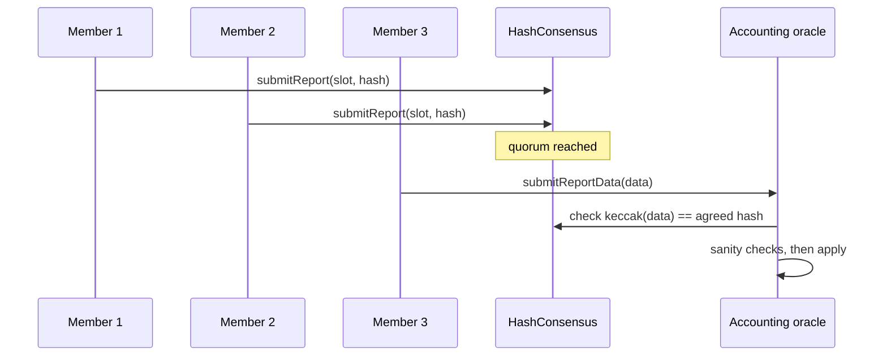

# Oracle Reports: Rewards, Slashing and Sanity Checks

An LST's value depends on validator balances that live on the beacon chain. Execution-layer contracts cannot simply read those balances in full, so most liquid staking protocols rely on an oracle: a set of members who read the beacon chain, agree on a report, and submit it on-chain. The report sets the exchange rate, finalises withdrawals and sometimes picks validators to exit. A wrong report can mint value from nothing or erase it. This chapter covers how reports work and how to bound them.

## What a report contains

| Field | Effect on-chain | Failure if wrong |
|---|---|---|
| Reference slot / epoch | Which beacon state the report describes | Old state replayed; rewards double-counted |
| Total validator balance (CL balance) | Sets `totalPooledEther` and the rate | Inflated: LST overvalued; deflated: holders lose |
| Number of active / exited validators | Tracks deposits in flight | Accounting gap between deposited and reported ETH |
| Withdrawal vault balance to pull | Moves swept ETH into the pool | Double counting with CL balance |
| Withdrawal requests to finalise | Locks ETH for queued redemptions | Users paid at wrong rate; queue stalls |
| Validators to exit | Signals operators to exit | Exits too many or too few |

Lido's v2 design splits this across an `AccountingOracle`, a `ValidatorsExitBusOracle`, a `HashConsensus` contract where members vote on report hashes, and an `OracleReportSanityChecker` that bounds values. Rocket Pool uses its oracle DAO (oDAO) to submit network balances. Read the current contracts; designs change between versions.

## Consensus on the report

The typical flow: each member computes the report off-chain, submits its hash, and once a quorum agree on the same hash, one member submits the full data, which must match the hash.



Security of this scheme reduces to: quorum size versus total members, independence of members (different clients, different infrastructure, different organisations), who can add or remove members, and whether a quorum can be reached with stale or fabricated data. A quorum running the same oracle software against the same beacon node provider is one point of failure, not several.

## Sanity checks

The contract should reject reports that are implausible even if a quorum signs them. Useful bounds:

```solidity
// Illustrative sanity checker
function checkReport(
    uint256 timeElapsed, uint256 preCL, uint256 postCL, uint256 newValidatorsDeposited
) external view {
    // allow for new deposits that became active
    uint256 expectedFloor = preCL + newValidatorsDeposited * 32 ether;
    if (postCL > expectedFloor) {
        // annualised growth must stay under a cap (e.g. 10% APR)
        uint256 growth = postCL - expectedFloor;
        require(growth * 365 days * 10_000 <= expectedFloor * maxAprBps * timeElapsed, "rebase too high");
    } else {
        // one-off drop limited (slashing is possible, but bounded per report)
        require((expectedFloor - postCL) * 10_000 <= expectedFloor * maxDropBps, "drop too large");
    }
    require(timeElapsed >= minReportInterval, "too soon");
}
```

Bounds trade safety against liveness. If a real mass-slashing event exceeds `maxDropBps`, the report is rejected and the rate stays too high, which favours early redeemers at the expense of later ones. Protocols handle this with special modes: Lido's "bunker mode" changes withdrawal finalisation when significant losses may be pending, so that early withdrawers cannot leave before losses are socialised.

## Slashing accounting

Slashing on Ethereum happens in stages: an initial penalty when slashed, then a correlation penalty around the midpoint of the withdrawal delay that depends on how many validators were slashed in the same period, then exit. A report taken in the middle can understate final losses. Good designs:

- track slashed validators and expected future penalties separately;
- delay withdrawal finalisation while slashing is in progress;
- never let the rate rise in a report that also shows new slashings without explicit review.

## Trust-minimised alternatives

EIP-4788 (Dencun) exposes the parent beacon block root to the execution layer. With it, a contract can verify Merkle proofs of beacon state, such as a validator's balance or withdrawal credentials, against a root it trusts. Several protocols and restaking systems use these proofs for parts of their accounting. Proof-based reporting removes the committee for the proven fields, but adds proof-verification code that must be audited and must handle beacon state layout changes across forks. See **zk-circuit-security** if proofs are wrapped in a SNARK.

## Worked example

_Not executed in this book's CI; verify locally._

Build a toy oracle and attack it on a local Anvil chain.

1. `forge init lst-oracle-lab`. Write `ToyLST` with `totalPooledEther`, `totalShares`, `submit()` and an `onReport(uint256 newCL)` callable only by a `ToyOracle`.
2. `ToyOracle` has three members and a quorum of two; it applies a report when two members submit the same `(slot, newCL)`.
3. Test 1: two honest members report a 0.01% increase; the rate rises as expected.
4. Test 2: two colluding members report a 50% increase. Show that an attacker holding LST can then redeem (or borrow against it in a toy lending pool) at the inflated rate.
5. Add the sanity checker above with `maxAprBps = 1000`. Rerun test 2 and confirm it reverts. Add a fuzz test over `postCL` and `timeElapsed` that asserts the rate never grows faster than the cap.
6. Run `slither .` and check for missing access control on `onReport`.

## Common pitfalls

- A quorum of members that all run the same software against the same node provider.
- Sanity bounds so tight that a real slashing event cannot be reported.
- Counting withdrawal vault ETH and beacon balance for the same validator twice.
- Accepting a report for an old reference slot.
- Letting the same multisig change oracle members and sanity limits instantly.

## Exercises

1. Read Lido's `OracleReportSanityChecker` and list each limit and its current value using `cast call` on a fork.
2. Extend the toy oracle to reject reports whose reference slot is not newer than the last one, with a test.
3. Write a Python script that recomputes an LST's exchange rate from two consecutive on-chain reports and flags annualised changes above 10%.

## Further reading

- Lido documentation, accounting oracle and oracle specification pages: <https://docs.lido.fi>
- EIP-4788 (beacon block root in the EVM): <https://eips.ethereum.org/EIPS/eip-4788>
- Ethereum consensus specs, slashing section: <https://github.com/ethereum/consensus-specs>
- **oracle-security-engineering** in this wiki
