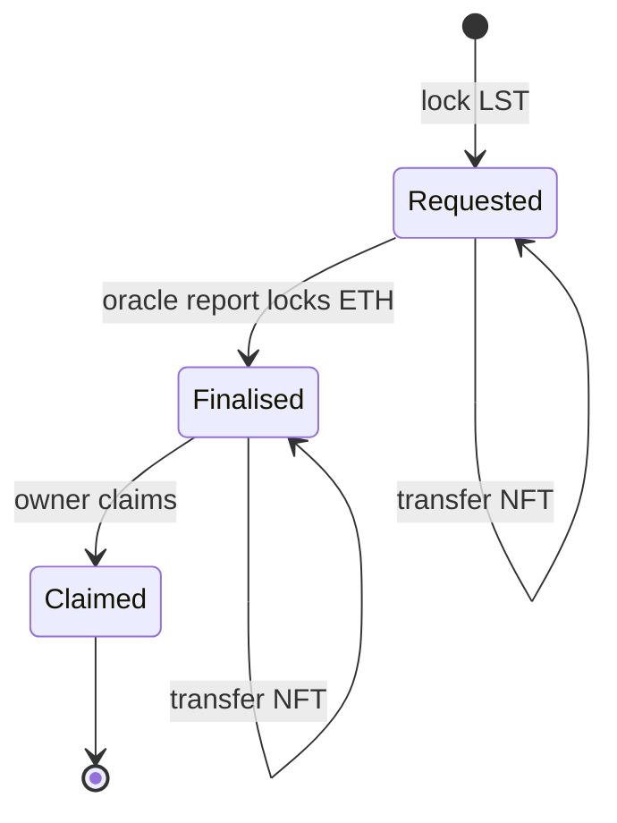

# Withdrawal Queues and Exits

Before the Shapella upgrade in April 2023, staked ETH could not be withdrawn at all, and LSTs could only be sold on secondary markets. Since then, protocols offer redemption, but it is not instant. ETH must come from somewhere: new deposits, swept rewards, or validators that exit, and exits wait in the beacon chain's exit queue. The withdrawal queue is the contract that turns this slow, variable process into fair claims. Bugs here mean users paid at the wrong rate, paid twice, or not paid at all.

## Sources of redemption liquidity

| Source | Speed | Limits |
|---|---|---|
| Buffered ETH (new deposits not yet staked) | Immediate | Small, varies with demand |
| Execution-layer rewards and swept consensus rewards | Each oracle report | Proportional to rewards |
| Validator exits | Days to weeks, depends on beacon exit queue length | Churn limit per epoch |
| Secondary market (DEX, OTC) | Immediate | Price discount when demand is high |

## Queue designs

**Request and finalise (Lido).** A user locks stETH and receives a request, represented as an ERC-721 (`unstETH`). Each oracle report finalises a batch of requests in order, locking ETH for them. The user then claims. The amount paid is the lower of the rate at request time and the rate at finalisation, so a holder cannot escape losses that happen while waiting, and does not earn rewards while in the queue.

**Burn against liquidity (Rocket Pool).** A user burns rETH for ETH at the current rate if the rETH contract or deposit pool has enough ETH; otherwise they must use a secondary market.

**Ticket with fixed rate.** Some smaller protocols lock the rate at request time. That lets a user who sees a slashing coming request a withdrawal before the loss is reported, pushing the loss onto everyone else.

```solidity
// Core of a fair finalisation: pay min(rate at request, rate at finalisation)
struct Request { uint128 shares; uint128 rateAtRequest; uint64 finalisedAt; bool claimed; }

function _payout(Request storage r, uint256 rateAtFinalise) internal view returns (uint256) {
    uint256 rate = rateAtFinalise < r.rateAtRequest ? rateAtFinalise : r.rateAtRequest;
    return uint256(r.shares) * rate / 1e18;
}
```

## Invariants

Write these down for any queue and test them:

1. **Conservation.** ETH locked for finalised requests equals the sum of their payouts; the pool's `totalPooledEther` excludes it.
2. **Ordering.** Requests are finalised in order; a later request is never finalised before an earlier one.
3. **No double claim.** A request can be claimed once; transferring the request NFT moves the claim, it does not copy it.
4. **No rate gaming.** Payout never exceeds the rate at request time.
5. **Liveness.** If enough ETH exists, every request is eventually finalisable without admin action.



## Things that go wrong

- **Share/ETH confusion.** Storing a request in ETH units with a rebasing token lets the user benefit from rewards (or dodge losses) during the wait. Store shares, or store both and take the minimum.
- **Batch boundaries.** Finalising a range of requests with a single rate is fine, but off-by-one errors at batch edges can skip or double-finalise a request.
- **Claim hints.** Lido's claim functions take "hints" (checkpoint indices) to save gas. The contract must validate hints, otherwise a wrong hint could select a better rate.
- **Discount bounds.** Finalisation with a rate far below request rate (a big slashing) is correct behaviour, but must not be triggerable by an oracle mistake; see chapter 3.
- **Integration with NFTs.** If the request is an ERC-721, `safeTransferFrom` calls `onERC721Received` on receivers, which is a reentrancy point. See **nft-marketplace-security**.
- **Exit selection.** The contract that picks which validators to exit can be gamed by operators if it is predictable and rewards differ.

## Exit pressure and the beacon chain

The beacon chain limits how fast validators can exit (the churn limit). During a run, the exit queue grows, and the gap between "I asked to withdraw" and "I have ETH" stretches. That gap is where secondary-market discounts appear; chapter 5 covers them. Pectra changed churn rules for balances above 32 ETH and added execution-layer triggered exits (EIP-7002). Recheck timing assumptions against the current consensus specs.

## Worked example

_Not executed in this book's CI; verify locally._

Exercise a withdrawal request end to end on a mainnet fork.

1. `anvil --fork-url $ETH_RPC_URL`. Get stETH as in chapter 1.
2. Approve and request a withdrawal on the Lido `WithdrawalQueueERC721` (find its address in Lido's deployed contracts page):

```bash
cast send $STETH "approve(address,uint256)" $WQ 1ether --private-key $PK --rpc-url $RPC
cast send $WQ "requestWithdrawals(uint256[],address)" "[1000000000000000000]" $ME --private-key $PK --rpc-url $RPC
cast call $WQ "getLastRequestId()(uint256)" --rpc-url $RPC
```

3. Read `getWithdrawalStatus([id])`: it should be unfinalised. Finalisation needs an oracle report, which you cannot produce honestly on a fork.
4. Instead, build a toy queue in Foundry using the `_payout` logic above, with a `finalise(uint256 upTo, uint256 rate)` function. Write invariant tests for the five properties listed earlier with a handler that requests, transfers, finalises (with random rates) and claims.
5. Introduce a bug (store ETH amount instead of shares) and confirm the invariant "payout ≤ rate at request" fails.

## Common pitfalls

- Fixing the payout rate at request time with no minimum against later losses.
- Letting users pass unchecked hints or indices that choose their payout rate.
- Forgetting that request NFTs trigger receiver callbacks.
- Excluding queued ETH from neither or both sides of the accounting.
- Assuming exit times from pre-Pectra documentation.

## Exercises

1. Read Lido's `WithdrawalQueueBase` and identify where the minimum of the two rates is enforced.
2. Add a "bunker mode" flag to your toy queue that pauses finalisation while slashings are pending, and test that no request finalises during it.
3. Write a Dune or web3.py query that measures average time from request to finalisation for the last 1,000 Lido requests.

## Further reading

- Lido withdrawals documentation: <https://docs.lido.fi>
- Rocket Pool rETH documentation: <https://docs.rocketpool.net>
- EIP-4895 (beacon chain push withdrawals): <https://eips.ethereum.org/EIPS/eip-4895>
- EIP-7002: <https://eips.ethereum.org/EIPS/eip-7002>
